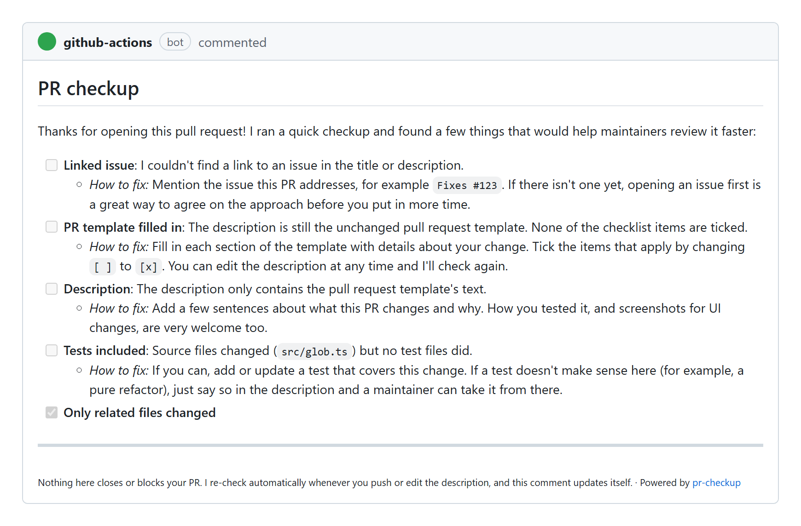

# pr-checkup

**A gentle PR triage bot for busy maintainers. It never closes a pull request.**

pr-checkup looks at every incoming pull request and leaves **one** friendly checklist comment
that tells the author exactly what's missing: a linked issue, a filled-in template, tests, a
real description. It adds a `needs-author-attention` label while something is missing,
re-checks on every push and edit, and **removes the label by itself** once the author has
fixed things. Maintainers get a clean "ready for review" signal, and newcomers get a
welcome and clear instructions instead of a closed PR.

- One sticky comment, edited in place, instead of a new bot comment on every run.
- A label that clears itself when the PR is ready.
- A welcome line for first-time contributors.
- Safe on `pull_request_target`: reads PR metadata through the API and never runs PR code.
- Seven checks, each with its own thresholds, level and wording.

## What contributors see

A pull request that left the template unfilled and changed source code without tests gets
this comment:



When the author pushes a fix, the same comment updates. Once everything passes it reads
"Everything looks good" and the label is removed.

## Setup

Create `.github/workflows/pr-checkup.yml`:

```yaml
name: PR checkup

on:
  pull_request_target:
    types: [opened, edited, synchronize, reopened, ready_for_review]

permissions:
  contents: read
  pull-requests: write
  issues: write

concurrency:
  group: pr-checkup-${{ github.event.pull_request.number }}
  cancel-in-progress: true

jobs:
  checkup:
    runs-on: ubuntu-latest
    steps:
      - uses: MAcemek/pr-checkup@v0
```

No checkout step and no config file are needed; the defaults are designed to be
useful out of the box. To customise, copy [`examples/pr-checkup.yml`](examples/pr-checkup.yml)
to `.github/pr-checkup.yml`.

## Inputs

| Input            | Default                  | Description                                                                                       |
| ---------------- | ------------------------ | ------------------------------------------------------------------------------------------------- |
| `github-token`   | `${{ github.token }}`    | Token used to read the PR, comment and label.                                                     |
| `config-path`    | `.github/pr-checkup.yml` | Config file path. Always read from the **base** branch.                                           |
| `label`          | `needs-author-attention` | Label added while something needs attention and removed once everything passes. `''` disables it. |
| `fail-on-issues` | `false`                  | Fail the workflow run when a required check doesn't pass (useful as a required status check).     |
| `dry-run`        | `false`                  | Run the checks and print the comment to the log without commenting, labeling or failing.          |

## Outputs

| Output          | Description                                                                 |
| --------------- | --------------------------------------------------------------------------- |
| `result`        | `pass`, `needs-attention` or `skipped`.                                     |
| `failed-checks` | Comma-separated IDs of the checks that did not pass, including suggestions. |

## Checks

| ID                | Default level | What it looks for                                                                                                     |
| ----------------- | ------------- | --------------------------------------------------------------------------------------------------------------------- |
| `linked-issue`    | required      | `#123`, `owner/repo#123`, `GH-123`, an issue/PR/discussion URL, or a closing keyword like `Fixes #123`.               |
| `template-filled` | required      | If the repo has a PR template: the body isn't the unchanged template, sections are filled, a box ticked.              |
| `description`     | required      | At least 30 characters written by the author (template text and HTML comments don't count), not just the title again. |
| `tests-included`  | required      | When source files change, a test file changes too.                                                                    |
| `unrelated-files` | required      | Lockfiles changed without their manifest, generated/vendored files, whitespace-only edits.                            |
| `diff-size`       | info          | More than 30 files or 800 changed lines (lockfiles and snapshots excluded): a nudge to split.                         |
| `pr-burst`        | info, **off** | The author opened more than 10 PRs across GitHub in the last 24 hours (uses the search API).                          |

**Levels:** a failing `required` check adds the label (and fails the run if `fail-on-issues`
is on). A failing `info` check only appears under "Suggestions" in the comment.

## Configuration

Everything is optional. Put a `.github/pr-checkup.yml` on your default branch and override
only what you need; the rest keeps its default. Lists replace the default list rather than
adding to it. Unknown keys and wrong types fail the run with a clear message, so typos don't
go unnoticed.

```yaml
skip:
  author_associations: [OWNER, MEMBER, COLLABORATOR]
  authors: [my-teammate]
  labels: [skip-checkup]

checks:
  linked-issue:
    require_keyword: true
  description:
    min_length: 80
    message: 'Please tell us a bit more ({length} of {min_length} characters so far).'
  diff-size:
    max_lines: 1500
  pr-burst:
    enabled: true
```

The fully commented reference with every key and its default is in
[`examples/pr-checkup.yml`](examples/pr-checkup.yml).

### Who gets checked?

PRs are skipped (no comment, no label) when:

- the author is a bot (`skip.bots`, default on),
- the PR is a draft (`skip.drafts`, default on; it is checked when marked ready for review),
- the author is an `OWNER`, `MEMBER` or `COLLABORATOR` (`skip.author_associations`),
- the author is listed in `skip.authors`,
- the PR has a label from `skip.labels` (default `skip-checkup`).

### Changing the wording

Every check accepts `message` and `how_to_fix` overrides with `{placeholders}`, and the
`messages` section controls the welcome line, intro, "all good" text and footer. The
available placeholders for each check are listed in the example config.

## Why not auto-close?

Tools that close low-quality pull requests automatically work well against spam, but they
also close PRs from real contributors who only missed a step. pr-checkup takes a softer
approach:

- It never closes or locks a PR. The worst outcome is a label and a checklist.
- It says what is missing and how to fix it.
- Every push re-runs the checks, and the label is removed when the PR is ready.
- It posts one comment per PR, edited in place, and nothing on PRs that already pass.

Filter your review queue with `-label:needs-author-attention` to see the PRs that are ready.
pr-checkup can also run alongside stricter tools.

## How it compares

|                                    | pr-checkup                | [Anti Slop](https://github.com/peakoss/anti-slop)               | [Vouch](https://github.com/mitchellh/vouch)             |
| ---------------------------------- | ------------------------- | --------------------------------------------------------------- | ------------------------------------------------------- |
| Approach                           | Triage checklist          | Rule-based filtering (34 checks, acts once `max-failures` fail) | Trust gating (an explicit list of vouched contributors) |
| Closes PRs                         | **Never**                 | Yes by default (`close-pr: true`), and can also lock            | Optional (`auto-close`, off by default)                 |
| Tells the author how to fix things | Yes, per check            | One custom message (`failure-pr-message`, empty by default)     | No, the author needs a vouch                            |
| Re-checks on every push            | Yes, and clears its label | Quick start runs on `opened` and `reopened` only                | Runs on `opened` and `reopened`                         |
| Welcomes first-time contributors   | Yes                       | No                                                              | No                                                      |

_Checked against each project's README in October 2026._

These tools solve different problems and can be combined.

## Security

pr-checkup is designed to run on `pull_request_target`, which has write access even for PRs
from forks. That is only safe because of how it works:

- It **never checks out or executes code from the pull request**. It reads the PR's title,
  body, author and file list (including diffs) through the GitHub API, and nothing else.
- The config file and the PR template are read from the **base branch**, so a PR can't
  change the rules it is judged by.
- It needs only `contents: read`, `pull-requests: write` and `issues: write`.

If you add other steps to the same job, **do not** check out
`${{ github.event.pull_request.head.sha }}` and run it: that is the classic
`pull_request_target` vulnerability.

## Try it locally

```bash
npm ci
npm run dry-run                                           # a PR that needs attention
npm run dry-run -- test/fixtures/scenarios/all-good.json  # a PR that passes
```

The dry run uses recorded fixtures and an in-memory fake of the GitHub API, so it works
offline and never touches GitHub. It prints the exact comment and job summary the action
would produce.

## FAQ

**Does it work on PRs from forks?**
Yes. That's why it uses `pull_request_target`; see [Security](#security).

**Will it spam my PRs?**
No. It posts at most one comment per PR and edits it in place. PRs that pass every check get
no comment at all, unless you set `comment.post_when_passing: true`.

**Can I make it a required status check?**
Yes. Set `fail-on-issues: true` and mark the job as required in your branch protection rules.

**My contributors are all on the team. Will it check them?**
Owners, members and collaborators are skipped by default. Change
`skip.author_associations` if you want them checked too.

**What if a check gets it wrong?**
Add the `skip-checkup` label to the PR, turn the check off with `enabled: false`, or lower it
to `level: info` so it only shows up as a suggestion.

**Does it use AI to judge PRs?**
No. Every check is a simple, predictable rule you can read in `src/checks/`.

**Which repository templates are supported?**
A single PR template at the usual paths (`.github/pull_request_template.md` and friends).
Multiple templates in `.github/PULL_REQUEST_TEMPLATE/` are not supported yet.

## Contributing

Contributions are very welcome! See [CONTRIBUTING.md](CONTRIBUTING.md).

## License

[MIT](LICENSE)
